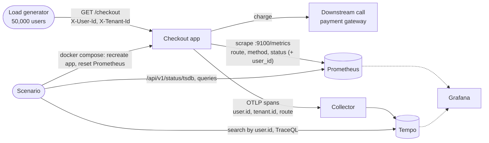

# Architecture

One small app whose metrics can be switched into a deliberate mistake, a real Prometheus that pays for it, a Collector
and Tempo that keep the detail where it belongs, and a scenario that runs the lesson end to end and reports numbers.
Component names match the lesson's diagram: load generator, downstream call, checkout app, Prometheus, trace backend.

## Components and what each owns

| Component | Owns | Does not own |
|---|---|---|
| **Load generator** (`cardinality_lab.lab.load`) | 50,000 simulated users and 200 tenants, seeded; sends `GET /checkout` with `X-User-Id` and `X-Tenant-Id` | knowing what the app does with them |
| **Checkout app** (`cardinality_lab.interfaces.main`) | `GET /checkout`, `GET /healthz`, `/metrics` on its own port (9100), the `checkout` span | storing metrics or traces |
| **Downstream call** (`SimulatedPaymentGateway`) | a fast call for everyone; two seconds slow when the route AND the tenant match the slow-dependency rule; the outcome (approved, declined, gateway error) | HTTP |
| **Prometheus 2.54.1** | the series, the head statistics (`/api/v1/status/tsdb`), the alert rules, the optional scrape guard | traces |
| **Collector** (contrib 0.111.0) | receiving OTLP traces, `memory_limiter`, `batch`, forwarding to Tempo | metrics |
| **Trace backend: Tempo 2.6.1** | one trace per request, searchable by `user.id`, `tenant.id`, `route` and duration | aggregation |
| **Grafana 11.2.0** | a dashboard as code over the three numbers and a TraceQL table | any data |
| **Scenario** (`cardinality_lab.lab.scenario`) | the six phases, the measurements, the report; recreates the app and Prometheus through `docker compose` | being imported by the app |

## Data flow

Drawn versions of this figure and of the walk-through: [the architecture](docs/diagrams/architecture.svg) and [one run](docs/diagrams/flow.svg).

### One run, step by step (`make run`)

1. **Baseline.** The scenario resets Prometheus to an empty TSDB with the plain config, recreates the app with
   `METRICS_INCLUDE_USER_ID=false`, sends 5,000 requests and waits for two scrapes. It records `prometheus_tsdb_head_series`,
   Prometheus's resident memory, the cost of the dashboard query `sum(rate(requests_total[5m])) by (route)`, and the
   samples in the last scrape of the app. It also computes the expected series count of the two metrics on paper
   (`domain.series.expected_series`).
2. **Blow up.** The app is recreated with `METRICS_INCLUDE_USER_ID=true`, which adds `user_id` to both metrics (the
   lesson's code change, as a switch). The full 200,000 requests from 50,000 users go in; the same three numbers are taken.
3. **Diagnose.** The scenario reads `/api/v1/status/tsdb` and takes the label with the most distinct values and the metric
   with the most series, with no knowledge of which label was added.
4. **Fix.** Prometheus is replaced by a fresh one that loads `prometheus.guarded.yml`; the app is recreated with the
   label off. `user.id` is on the `checkout` span in every phase, so a search of Tempo for one user returns exactly that
   user's requests.
5. **Guard.** The label is switched back on (the careless change six months later). The guard strips `user_id` at scrape
   time, so the series count stays at the baseline.
6. **Hidden slow dependency.** The downstream call is made slow for one route and one tenant. The scenario measures the
   route's p95 before and after (barely moves) and then finds the slow requests with a TraceQL query on tenant, route and
   duration.

## The pattern and the layers

Ports and adapters. `domain/` holds identifiers (validated at the boundary, so a hostile header can never become a
label value or a span attribute), outcomes, the slow-dependency rule and the series arithmetic. `application/` holds the
`Checkout` use case and four ports (`CheckoutMetrics`, `RequestTracer`, `PaymentGateway`, `Clock`).
`infrastructure/` implements them with `prometheus_client`, OpenTelemetry and a simulated gateway. `interfaces/` is the
Flask surface and the composition root. `lab/` (the experiment) is a sibling of `interfaces/` and is never imported by
the app. `import-linter` enforces the direction in `make lint`; the domain and application layers may not import
Flask, `prometheus_client`, `requests` or OpenTelemetry.

The pattern fits because the whole lesson is about what crosses one boundary (the metrics adapter) and what crosses
another (the tracing adapter) for the same request: `Checkout.execute` hands the user to both, and each adapter decides
what to keep.

## Decisions and trade-offs

- [0001](docs/adr/0001-the-mistake-is-a-switch-in-the-metrics-adapter.md): the user_id label is a configuration switch in
  one adapter, so the scenario can make, measure and undo the mistake without editing code.
- [0002](docs/adr/0002-guard-in-the-scrape-config-not-the-collector.md): the guard is a `labeldrop` in Prometheus's
  scrape config, because the metrics never pass through the Collector.
- [0003](docs/adr/0003-a-fresh-prometheus-for-the-post-fix-measurement.md): the post-fix series count is measured on a new
  Prometheus, because an old one keeps series in its head for about two hours.
- [0004](docs/adr/0004-five-latency-buckets.md): five latency buckets, not eleven, to keep the blown-up run within the
  memory of a laptop's Docker VM.

## Failure modes the lesson teaches, and where the code shows them

| Failure | Where it shows |
|---|---|
| An unbounded label multiplies every series | `METRICS_INCLUDE_USER_ID=true`; `tests/unit/infrastructure/test_prometheus_metrics.py` shows the multiplication in-process (200 users, 200 times the series) before the scenario shows it in Prometheus |
| Growth is visible but its cause is not | step 3 reads `labelValueCountByLabelName` and `seriesCountByMetricName` instead of looking at the code |
| "Fixing" it by shortening retention or the scrape interval | not done: every new user id would still create a new permanent series; the report shows the series count falling because the label is gone |
| The mistake comes back | step 5; the `MetricLabelGuardTriggered` alert fires on the duplicate samples the guard produces |
| An aggregate hides a slow slice | step 6; the route's p95 does not move while 40 traces show a 2-second downstream span |
| Measuring query time with a result whose size changes | the dashboard query always returns one row (`sum ... by (route)`) |

## Limits of the teaching build against a production one

- One Prometheus, local disk, no remote write, no long-term store; production would shard or use a managed backend with
  its own series limits.
- `labeldrop` makes the dropped label's series collide and keeps one sample per scrape, so the counter's value after a
  guarded re-add is wrong (the cardinality is protected, the numbers are not). The alert exists so a human fixes the code;
  production backends offer per-metric series limits that reject the new series instead.
- The simulated gateway stands in for a real dependency, with a configured delay.
- Traces are not sampled and not redacted (project 3 does both).
- The app's host port is published for the load generator; the metrics port is not published at all.

## How to extend it

- **Native histograms** (the lesson's stretch): enable `--enable-feature=native-histograms`, switch the client to a
  native histogram, and compare `prometheus_tsdb_head_series` on the same traffic.
- **A cardinality limit in the Collector:** route the app's metrics through the Collector (OTLP) and add a limiting
  processor; then the guard moves from the scrape config to the pipeline.
- **Wide events:** write one record per request to a columnar store and answer the tenant question with one query.
